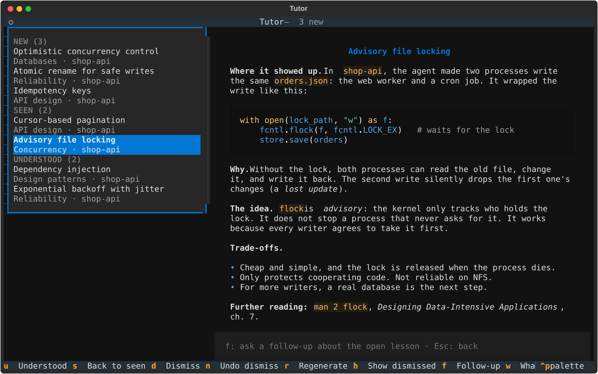
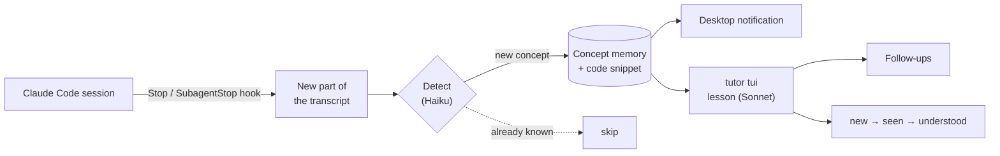

<div align="center">

# 🎓 tutor-agent

**A tutor that watches your Claude Code sessions and teaches you the concepts behind what the agent just did.**

[](https://github.com/JakobAyo/tutor-agent/actions/workflows/ci.yml)
[](https://www.python.org/)
[](https://docs.claude.com/en/docs/claude-code)
[](#requirements)
[](LICENSE)



<sub>The tutor pane (<code>tutor tui</code>), with demo data.</sub>

</div>

---

Coding agents write code faster than you can learn from it. `tutor-agent` runs quietly next to
them. At the end of each agent turn it reads what happened, spots concepts that are new to *you*
(patterns, architecture, mechanisms, trade-offs, not syntax) and sends a desktop notification.
When you have a minute, open the tutor pane: each lesson starts from the real code where the
concept appeared, then generalizes, explaining *why* the agent did it and not only *what*.

> [!NOTE]
> It never blocks or changes your agent session, and it never writes code for you.

## Features

|   |   |
|---|---|
| **Watches, never interferes** | A background hook reads each finished turn. Your session never waits on it. |
| **Only what's new to you** | A global concept memory remembers what you already know, so you are not taught twice. |
| **Lessons from your own code** | Every lesson starts from the snippet where the concept appeared, then generalizes. |
| **Follow-ups and "what just happened?"** | Ask questions under a lesson, or get the latest turn of a session explained. |
| **Progress you control** | Concepts move `new` → `seen` → `understood`, or get `dismissed`. |
| **Cheap** | Detection uses a Haiku-class model; lessons are cached. Runs on your Claude Code login. |

## How it works



1. **Observe:** a Claude Code `Stop` / `SubagentStop` hook fires after each agent turn and hands
   the new part of the session transcript to a detached background process.
2. **Detect:** a cheap model picks out concepts worth learning and stores them in a local concept
   memory (`~/.local/share/tutor-agent/`), with the code snippet where each appeared.
3. **Teach on demand:** `tutor tui` opens a terminal pane. Pick a concept to get a lesson from a
   stronger model, ask follow-ups, or ask "what just happened?" about a recent session.
4. **Track progress:** each concept moves `new` → `seen` → `understood` (or `dismissed`).

All model calls go through `claude -p` on your existing Claude Code login, sandboxed: no tools,
no MCP servers, no session persistence.

## Requirements

- Linux (notifications use `notify-send`)
- Python 3.12+ and [uv](https://docs.astral.sh/uv/)
- [Claude Code](https://docs.claude.com/en/docs/claude-code), installed and logged in

## Install

```sh
uv tool install git+https://github.com/JakobAyo/tutor-agent
tutor install          # adds the hook to ~/.claude/settings.json (shows a diff, asks, backs up)
```

Then open `tutor tui` in a terminal pane next to your agent. Remove the hook with
`tutor uninstall`.

## Usage

| Command | What it does |
|---|---|
| `tutor tui` | The tutor pane (keys below). |
| `tutor explain [N] [--list]` | Explain the latest turn of recent session N (one model call). `--list` makes no call. |
| `tutor stats [--days N]` | Concept memory size and model usage per day (no call). |
| `tutor detect <transcript.jsonl> --dry-run` | Log the next batch without detecting, for debugging. |

**Keys in the tutor pane:** <kbd>Enter</kbd> open lesson · <kbd>f</kbd> follow-up ·
<kbd>w</kbd> what just happened · <kbd>u</kbd> understood · <kbd>s</kbd> back to seen ·
<kbd>d</kbd> dismiss · <kbd>n</kbd> undo dismiss · <kbd>r</kbd> regenerate · <kbd>h</kbd> show dismissed

Settings (models, timeouts, mute) live in `~/.local/share/tutor-agent/settings.toml`.

## Contributing

Contributions are welcome. See [CONTRIBUTING.md](CONTRIBUTING.md) for the dev setup, the branch
flow, and how releases work. Design decisions are recorded as ADRs in
[`docs/decisions/`](docs/decisions/). The screenshot above is generated with
`uv run python scripts/readme_screenshot.py`.

## License

[MIT](LICENSE)
