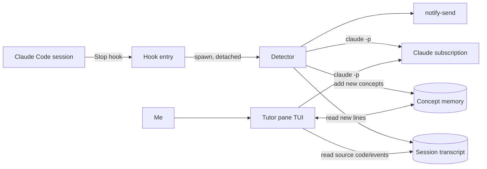

# Architecture Overview

> **Responsibility:** High-level picture: the components and how they fit together.

Two flows share one concept memory ([0007](../decisions/0007-interaction-model.md)).

## Detection flow (background)
1. The agent finishes a turn, and the hook fires with the session id and transcript path.
2. The hook starts the detector in the background and returns at once.
3. The detector reads new transcript lines into a batch, pre-filters it, and calls `claude -p` with the batch plus the list of known concept names.
4. Concepts that are new and worth knowing are added as `new`, and one desktop notification is sent.

## Learning flow (on demand)
1. I open the tutor pane and pick a concept, or ask about a recent session.
2. For a concept, the pane builds the lesson from the stored snippet with one `claude -p` call (cached), and the status changes to `seen`. I mark `understood` myself.
3. I can ask follow-ups under the lesson. Each is a fresh call with the lesson, the thread and what I know ([0029](../decisions/0029-follow-ups-and-latest-turn.md)).
4. For a session, the pane reads its latest turn (with subagent work) from the transcript and explains it with one call.

Details: [components](components.md), [data storage](data-storage.md), [tech stack](tech-stack.md).
