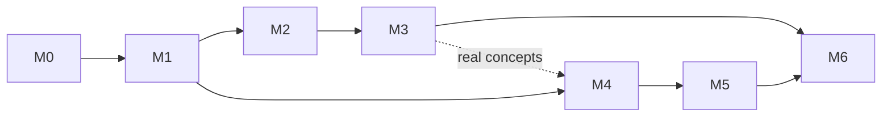

# Milestones Overview

> **Responsibility:** The order of the milestones, how they depend on each other, and which requirements each one delivers.

Each milestone leaves the tutor in a working, testable state. One file per milestone, with its goal, scope, and "done when" criteria.

| # | Milestone | Delivers | Depends on |
|---|---|---|---|
| M0 | [Spike](m0-spike.md) | Answers to every open technical question, recorded in the docs | none |
| M1 | [Foundation](m1-foundation.md) | Project skeleton, CLI, settings, concept store, Claude runner | M0 |
| M2 | [Observation pipeline](m2-observation.md) | Hook → transcript → event batches, with no LLM calls | M1 |
| M3 | [Detection and notifications](m3-detection.md) | Concepts land in the memory, plus a desktop notification | M2 |
| M4 | [Tutor pane: browse and lessons](m4-tutor-pane.md) | TUI with the concept list, lessons, cache, and status changes | M1 (needs M3 for real data) |
| M5 | [Follow-ups and "what just happened"](m5-follow-ups.md) | Follow-up questions and on-demand explanation of the latest turn | M4 |
| M6 | [Daily use and tuning](m6-daily-use.md) | Two weeks of real use, prompt tuning, a check against the goals | M5 |

## Requirements per milestone
| Requirement | Milestone |
|---|---|
| F1, F2, F3 (detect) | M3 (trigger and batching in M2) |
| F4 (notify) | M3 |
| F5, F6, F7 (browse, lesson, status) | M4 |
| F8 (explain what just happened) | M5 |
| F9 (follow-ups) | M5 |
| F10 (dismiss) | M4 (pane), M3 (detector respects it) |
| Non-functional: non-blocking hook, robustness | M2 |
| Non-functional: no side effects, no self-observation, secrets | M1 |
| Non-functional: concurrency | M1 (store), M2 (offsets) |
| Non-functional: usage budget, interruption limit | M3 |

## Parallel work
M4 only needs the concept store from M1. It can be built against a hand-written concept memory while M2 and M3 are in progress.

## Rules
- A milestone is done only when all its "done when" items are checked.
- Findings that change the design become ADRs. Milestone files plan work; they don't record decisions.
